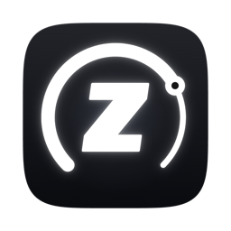

<div align="center">
  
  <h1>ZyManager</h1>
  <p><b>Storage and memory manager for developers on macOS.</b></p>
  <p>A <a href="https://conaksoft.com">Conaksoft</a> product</p>
</div>

---

## Overview

**ZyManager** is a native macOS app by [Conaksoft](https://conaksoft.com) for developers whose Mac keeps running out of disk space and memory. It knows which developer folders can be safely deleted and recreated: Xcode DerivedData, simulator caches, Gradle, Android SDK versions, npm, Flutter/Dart, pip, Composer, Homebrew and more. It shows how much space each one takes and cleans it only after you confirm.

**Who is it for?** Developers who work with several stacks (Flutter, TypeScript, Python, PHP, iOS, Android) on a Mac with a small SSD or 8 GB of RAM.

## Key Features

- **Developer cache analysis:** Scans the known cache folders of Xcode, Android/Gradle, Flutter/Dart, Node.js (npm, Yarn, pnpm, Bun), Python (pip, uv, Poetry), PHP (Composer), Homebrew, CocoaPods, VS Code, Cursor and Chrome. Each item is labelled *Regenerable* or *Caution*.
- **Project dependency cleanup:** Finds `node_modules`, `.dart_tool`, Flutter `build`, `.next`, Gradle `.gradle`, `Pods`, Composer `vendor` and Python virtual environments in your project folders, shows when you last touched each project and the command that restores it.
- **App uninstaller:** Lists third-party apps with size, version and last-used date, highlights apps you haven't opened for 90+ days, and finds the files each app leaves in `~/Library` (support files, caches, containers, preferences, saved state). The app goes to the Trash like in Finder.
- **Safe by default:** Nothing is deleted without a confirmation screen that lists every folder and the space it frees. You can move items to the Trash instead of deleting them.
- **RAM and swap monitor:** Memory pressure, used RAM, compressed memory and swap usage, with helper processes grouped under their app (for example all Chrome helpers). When memory is tight it tells you which apps would free the most memory if closed. It never pretends to "free RAM".
- **Menu bar:** Swap usage always visible, with a compact view of memory, free disk space and reclaimable space.
- **Keyboard shortcuts:** ⌘1–⌘5 switch sections, ⌘R rescans the current section, and the cache, project and app lists are searchable.

## Requirements

- macOS 14 Sonoma or later (Apple Silicon or Intel)

## Installation

ZyManager is distributed as source code. Build it on your Mac as described below.

## Building from Source

You need **Xcode 16** (Swift 6 toolchain) or later.

```bash
git clone https://github.com/conaksoft/zymanager.git
cd zymanager
./build-app.sh
open build/ZyManager.app
```

ZyManager is a Swift Package written in SwiftUI with no third-party dependencies. `./make-icon.sh <1024px.png>` regenerates the app icon.

## Security & Privacy

- ZyManager works entirely on your Mac. It does **not** collect telemetry, analytics or usage data, and does not send anything to Conaksoft.
- It only reads and removes the folders shown on screen, inside your home folder and `/Applications`.
- It is not sandboxed, because the folders it manages (`~/.gradle`, `~/Library/Caches`, `~/Library/Developer` and so on) are outside an App Store sandbox.

## Disclaimer

> **Please read carefully before using ZyManager.**

1. **Provided "as is".** ZyManager is provided "AS IS" and "AS AVAILABLE", without warranty of any kind, express or implied. This includes, without limitation, warranties of merchantability, fitness for a particular purpose, accuracy and non-infringement.
2. **Limitation of liability.** To the maximum extent permitted by applicable law, Conaksoft and its contributors are not liable for any direct, indirect, incidental, special, consequential or exemplary damages. This includes loss or corruption of data, loss of profits or service interruption, arising from the use of or inability to use ZyManager, even if advised of the possibility of such damages.
3. **Deletion is your decision.** ZyManager deletes or moves to the Trash only what you select and confirm. Items marked *Caution* (for example Android emulators, system images and Xcode archives) are not recreated automatically. App support files can contain settings, profiles and sessions that are lost if you reinstall the app later. **Review the confirmation screen and keep backups** of anything important.
4. **Regenerable does not mean free.** Deleted caches and dependencies are downloaded or rebuilt the next time a tool needs them, which takes time and network traffic.
5. **Trademarks.** Apple, macOS, Xcode, Android, Gradle, Flutter, npm, Visual Studio Code, Chrome and other names are trademarks of their respective owners. ZyManager is not affiliated with, endorsed by or sponsored by any of them.

By installing or using ZyManager you agree to these terms.

## License

ZyManager is **source available** under the [PolyForm Noncommercial License 1.0.0](LICENSE).

- **Free** for personal use, study, research, hobby projects and non-profit organizations.
- **Commercial use requires a license.** This includes using ZyManager at work or inside a company, selling it, or building a product or service on it. Write to [contact@conaksoft.com](mailto:contact@conaksoft.com) for a commercial license.
- The ZyManager name and logo are not covered by the license and may not be used for other products.

## Türkçe Özet

**ZyManager**, [Conaksoft](https://conaksoft.com) tarafından geliştirilen, yazılımcılar için bir macOS depolama ve bellek yöneticisidir. Xcode, Android/Gradle, Flutter, Node.js, Python, PHP ve Homebrew önbelleklerini, projelerdeki `node_modules`, `.dart_tool` ve `build` gibi klasörleri bulur; neyin güvenle silinebileceğini gösterir ve yalnızca onayınızla temizler. Kurulu uygulamaları `~/Library` altındaki kalıntı dosyalarıyla birlikte kaldırabilir, RAM ve swap kullanımını menü çubuğundan izler. Uygulama hiçbir kullanım verisi toplamaz.

**Sorumluluk reddi:** ZyManager "olduğu gibi" sunulur ve hiçbir garanti verilmez. Yürürlükteki mevzuatın izin verdiği en geniş ölçüde Conaksoft, uygulamanın kullanımından doğan veri kaybı ve hizmet kesintisi dahil hiçbir doğrudan veya dolaylı zarardan sorumlu değildir. Uygulama yalnızca sizin seçip onayladığınız öğeleri siler; "Dikkat" işaretli öğeler kendiliğinden geri gelmez. Önemli verilerinizin her zaman yedeğini alın. Uygulamayı kurarak veya kullanarak bu koşulları kabul etmiş sayılırsınız.

**Lisans:** ZyManager'ın kaynak kodu [PolyForm Noncommercial 1.0.0](LICENSE) lisansıyla açıktır. Kişisel, eğitim, araştırma ve kâr amacı gütmeyen kullanım ücretsizdir. İş yerinde kullanım, satış veya ticari bir ürüne dahil etme gibi ticari kullanımlar için [contact@conaksoft.com](mailto:contact@conaksoft.com) adresinden lisans alınması gerekir.

---
<div align="center">
  <p>ZyManager is a product of <a href="https://conaksoft.com">Conaksoft</a>.<br>Copyright © 2026 Conak Soft LLC · <a href="LICENSE">PolyForm Noncommercial 1.0.0</a></p>
</div>
